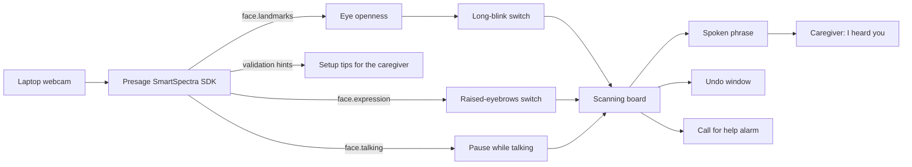

# Hear Me: a blink becomes a voice

Hear Me is a free desktop app for people who cannot speak or use their hands, after a stroke or with ALS, for example. It needs only a laptop webcam. A highlight steps through a board of everyday phrases. The person holds a long blink to choose one, and Hear Me speaks it aloud in English or Hindi.

Eye-gaze communication devices often cost more than a family can pay. Hear Me runs on a laptop the family already has.

## What it does

- **Phrase board.** Call for help, yes, no, pain, water, food, toilet, medicine, turn me over, too hot or cold, call the nurse or family, thank you, and more. Each phrase is shown in English and Hindi, and spoken in the language you pick.
- **Long blink to select.** A natural blink (about 100 to 300 ms) is ignored. A deliberate long blink (0.5 to 5 s) selects. Eyes closed for longer (resting) select nothing. The highlight holds still while the eyes are shut, so the choice is the one they closed their eyes on.
- **Calibration.** 20 seconds: blink normally, then do three long blinks. Hear Me sets the threshold from that person's own blinks, never below 500 ms, so a slow natural blink (looking down) does not select.
- **Pauses while the person talks.** If they can say a few words, talking never triggers a choice.
- **Raised eyebrows as a second switch** (optional), for people whose blinks are weak.
- **Letter board** for anything not on the phrase board, with the most common letters first and word suggestions (type W, A and WATER is one select away).
- **Your own phrases.** A caregiver types up to five phrases ("Call Mummy", "Switch on the fan") and they appear as a "Mine" row.
- **Eye meter.** A live bar shows the caregiver whether Hear Me sees the eyes open, closed, or no face at all.
- **Never scans blind.** If the face is badly placed, the board pauses and says what to fix ("Move up, or tilt the camera down"). If the SDK stops after an error, Hear Me restarts it on its own.
- **Undo a wrong phrase.** Right after a phrase is spoken, the board holds still for 3 seconds. One more long blink takes it back ("Sorry, not that") and puts the highlight back on that phrase. Switch-scanning devices use the same idea. Call for help is never undone.
- **"I heard you".** A caregiver presses the button (or H) and the person sees that their message got through.
- **Call for help.** It is the first item on the board, so it is two selects away. Four quick long blinks also sound the alarm from anywhere. A caregiver stops it with "I'm here".
- **Space bar or any USB switch** works as a select too, so a caregiver can try the board.

## How it uses the Presage SmartSpectra SDK



A **LIVE · Presage SmartSpectra** panel in the app shows the raw values as they arrive (face tracked, eye openness, talking, eyebrows score, frames per second), so a caregiver or a judge can see what Hear Me is reacting to.

Hear Me runs the [SmartSpectra SDK](https://github.com/Presage-Security/SmartSpectra) in Electron, using the camera's face signals:

| Signal | Used for |
|---|---|
| `face.landmarks` (478 points) | eye openness from the six points around each eye: the long-blink switch, calibration and the eye meter |
| `face.talking` | pausing the board while the person speaks |
| `face.expression` (surprise score) | the optional raised-eyebrows switch |
| validation hints | on-screen help for the caregiver ("Face the camera", "Increase light on face") |

The SDK's own `face.blinking` flag marks only the moment of a blink, not how long the eyes stay shut, so Hear Me measures a held blink from the eye landmarks (the eye aspect ratio) against each person's own open-eye level. The face tracker drops landmarks while the eyes are fully shut, so a gap right after the eyes start closing counts as closed. This was tuned and tested on a real recording (`fixtures/eyes-1.json`, eye points only).

The camera stream runs at 640x360 and 30 fps, which keeps the SDK's frame rate on an ordinary laptop CPU. Hear Me picks the built-in camera over virtual cameras.

## Limits

- Tested on one person (the author). It has not been tested with people who have ALS or after a stroke, or with glasses and low light.
- The alarm is a sound from the laptop: it needs the volume up and is not an emergency call system.
- It is a communication aid, not a replacement for a clinical AAC assessment or dedicated assistive technology.

## Camera consent and data handling

- **Consent.** The camera turns on only after the caregiver or user presses **Turn on the camera and start**, and turns off with **Stop camera**. Hear Me asks for the camera only (no microphone), and only for its own window.
- **Processing.** The SmartSpectra SDK processes the video on this computer. Presage's SDK documentation says vitals are computed on-device and its telemetry sends no raw video. Hear Me does not record, upload or save any video, image or measurement.
- **Network.** The SDK contacts Presage's server to check the API key and count measurement credits. SDK telemetry is turned off (`enableTelemetry: false`). Hear Me itself sends nothing anywhere: no analytics, no AI service.
- **Speech.** Phrases are spoken with the voices installed on the computer. The list of phrases said in a session is shown on screen and is not saved.
- **What is stored, and for how long.** Only two things, both on this computer, kept until you delete them: the API key you paste (a file in the app's data folder) and the settings (scan speed, language, blink threshold, raised-eyebrows switch, privacy view, the caregiver's own phrases) in the app's local storage.
- **Deletion.** On the start screen, **Delete my saved key and settings from this computer** removes the key, the settings and the own phrases (two clicks, so it can't happen by accident). Uninstalling the app and its data folder removes everything too.
- **Sharing.** Nothing is shared with anyone.
- Hear Me is a communication aid. It does not diagnose, treat or monitor any condition, and it is not a replacement for a clinical AAC assessment or an emergency call system.

## Setup

Requires Windows x64, macOS (Apple Silicon) or Linux x64, Node.js 20 or newer, and a webcam.

```bash
git clone <this repo>
cd hear-me
npm install
npm start
```

On the first start Hear Me asks for your Presage API key (free at physiology.presagetech.com). Paste it and press **Save key**. It is stored only in the app's data folder on this computer. Developers can put `SMARTSPECTRA_API_KEY=...` in a `.env` file instead.

Then, in under a minute:

1. Sit facing the laptop, face well lit, about an arm's length from the camera.
2. Press **Calibrate** (20 s): blink normally, then do three long blinks.
3. Close your eyes for about one second while the phrase you want is lit. Hear Me says it aloud. The **Space** bar works as a select too, so you can try the board without blinking.

If the key is wrong or has run out of measurement credits, Hear Me stops the camera and says so, instead of retrying forever.

- Check the camera on its own: `node tools/camera-check.mjs 30` prints which face signals arrive.
- Record your own face data: `node tools/record-face.mjs out.json 30`.
- Replay a recorded clip instead of the camera: `npx electron . --replay=clip.mp4` (add `--background` to run without a window, for automated checks).
- Run the tests: `npm test`.
- Benchmark the long-blink switch on recorded eye landmarks (no camera or credits needed): `node tools/benchmark.mjs`. It reports natural blinks, false selects and missed long blinks per clip. Only the public recording (`fixtures/eyes-1.json`) ships with the repo; it is one person, so it shows the method, not accuracy across people.

## Tips

- Sit alone in the frame, face the camera, with light on the face. The SDK stops if it sees two faces.
- Start with a slow scan speed (2 to 3 s) and calibrate once per person.

## Limits

- Blink detection depends on light and camera position. Run calibration again if choices are missed or happen by accident.
- Speech uses the voices installed on the computer. For Hindi, add a Hindi voice in Windows settings.

## License

MIT. The SmartSpectra SDK has its own license from Presage Technologies.

---

Made by **Wageesha Tripathi** · [LinkedIn](https://www.linkedin.com/in/wst2002/) · [Email](mailto:tripathiwageesha2002@gmail.com) · [GitHub](https://github.com/WST2002) · [YouTube](https://www.youtube.com/@wst2002rk)
